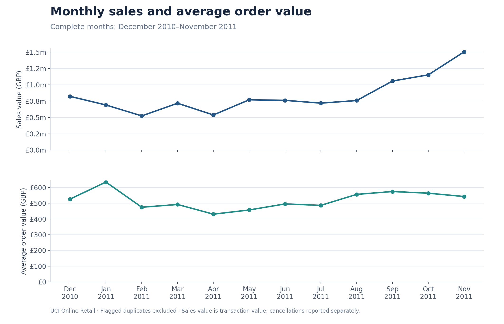
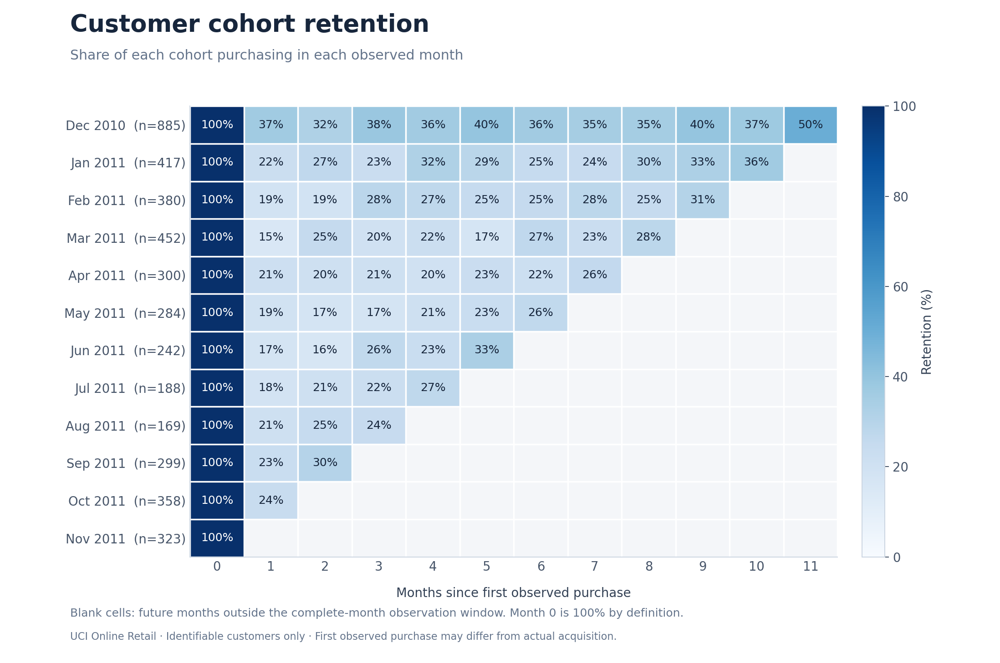
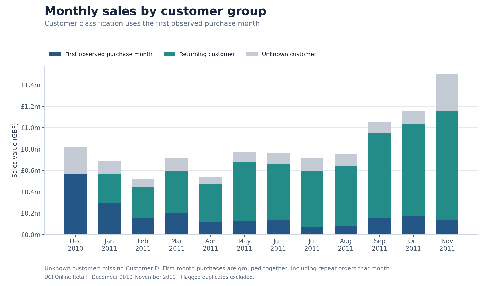

# Retail Revenue & Retention Analytics

An e-commerce analytics project examining sales performance, repeat purchasing and customer retention using UCI Online Retail.

**Status:** In progress. Python data preparation, complete-month analysis, visualisations and duplicate sensitivity checks are implemented. All six SQL queries have been executed using PGlite, a WebAssembly build of PostgreSQL, and reconciled against Python outputs. Verification on a native PostgreSQL server remains pending. A dbt project is authored and parsed; its model SQL and equivalent quality assertions passed direct PGlite checks. Full dbt build verification remains pending. A Power BI authoring package is prepared; execution and report validation in Power BI remain pending.

## Business question

Which products, countries and customer groups contribute most to sales value, and how do repeat purchases shape business performance?

## Key results

For the twelve complete months from December 2010 to November 2011:

- GBP 10,004,320.47 in eligible sales value across 19,141 orders.
- Average order value of GBP 522.66.
- 64.21% repeat purchase rate among 4,297 identifiable customers.
- Including flagged duplicates increases sales value by approximately 0.24%. Order counts and the repeat purchase rate remain unchanged.

Sales value is transaction value under the documented preparation rules. It is not profit or audited accounting revenue. Many customers are wholesalers.

## Visual analysis

### Monthly sales and average order value



### Customer cohort retention



Cohorts use the first purchase observed in the dataset. Blank cells indicate months outside the observation window, rather than zero retention.

### Sales by customer group



Customers are classified by their first observed purchase month. Sales without CustomerID remain a separate group.

## Implementation

- [Data preparation](src/prepare_data.py): preserves source rows, flags duplicates and cancellations, and exports a compressed CSV and quality report.
- [Python analysis](src/analyse_data.py): calculates monthly sales, cancellations, orders, average order value, repeat purchasing, cohort retention, country and stock-code contribution.
- [Visualisations and sensitivity checks](src/build_visuals.py): generates the figures and compares results with and without flagged duplicates.
- [PostgreSQL schema](sql/01_schema.sql) and [six analytical queries](sql/02_analysis.sql).
- [Metric definitions and loading instructions](docs/metric_definitions.md).
- [dbt project and run guide](dbt/README.md): 10 models, source/model documentation, 48 data tests and credential-free profile configuration.
- [dbt validation evidence](reports/dbt_validation.json): parse status, direct SQL checks and comparison of all six marts against Python.
- [Power BI authoring package](powerbi/README.md): reconciled CSV inputs, Power Query definitions, DAX measures, relationships, theme and a clearly labelled design preview. Power BI execution remains pending.
- [Findings and limitations](reports/findings.md).
- [SQL validation results](reports/sql_validation.json): full-data execution in PostgreSQL 18.3 via PGlite 0.5.8, with all six outputs compared against Python.

Python sales totals reconcile across monthly, country, stock-code and customer-group summaries. Cohort rates and reporting-period boundaries were checked. SQL validation loaded all 541,909 prepared rows. Sales amounts, cancellation amounts, counts and units match Python exactly; average order values and rates match within the tolerances recorded in the validation report. Execution used PGlite rather than a native PostgreSQL server.

## Reproduce the Python analysis

Download the official source from [UCI Online Retail](https://archive.ics.uci.edu/dataset/352/online%2Bretail) and extract the workbook locally. Install pandas, openpyxl, matplotlib and numpy in your Python environment, then run from the repository root:

```bash
python src/prepare_data.py "/path/to/Online Retail.xlsx"
python src/analyse_data.py data/processed/retail_lines.csv.gz
python src/build_visuals.py data/processed/retail_lines.csv.gz
```

Generated tables and summaries are written to `reports/`; figures are written to `assets/`. The raw dataset is not included in this repository.

## Methodological considerations

Missing CustomerID records are excluded from customer-level metrics but retained in sales reporting. Cancellations are reported separately by cancellation date. Exact duplicates after the first occurrence are excluded from the base case, with an inclusion sensitivity comparison.

Non-positive prices and negative quantities without a cancellation prefix are retained for inspection and excluded from eligible sales and cancellation views. December 2011 is incomplete and excluded from complete-month comparisons. First observed purchase is not necessarily actual customer acquisition. Delivery and adjustment stock codes require review before merchandise-level recommendations.

## Next development steps

- Repeat the validated SQL workflow on a native PostgreSQL server.
- Run the authored dbt project with `dbt build` and generate its documentation on a native PostgreSQL server.
- Import the prepared Power BI package, execute its Power Query/DAX definitions and validate the report against the recorded acceptance checks.
- Investigate customer segments and review merchandise versus non-merchandise stock codes.

## Data source

Chen, D. (2015). Online Retail [Dataset]. UCI Machine Learning Repository. https://doi.org/10.24432/C5BW33.

Dataset license: CC BY 4.0. Figures and summaries are derived from this dataset using the documented analytical rules.
