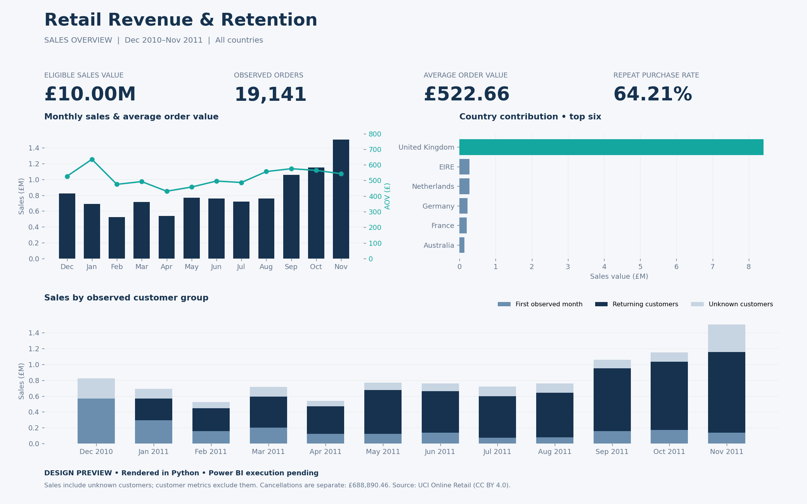

# Power BI authoring package

## Status

The three-page report was built, validated in Power BI Service and published on 16 October 2026. **[Open the public interactive report](https://app.powerbi.com/view?r=eyJrIjoiNmZlODc0YmEtOTZkNi00YjliLThlOGQtYjQxNjUyNjg5MTVhIiwidCI6ImY2Yjg5MjUzLWNmZjEtNGEyYS05YmM5LWEzZjI3ZWU5MjNiMSIsImMiOjh9)**. No sign-in is required. No PBIX/PBIP export is included.

The Service model uses uploaded CSVs with en-GB parsing for monetary fields and text identifiers. DimMonth and DimCountry were derived from FactOrders and checked against the prepared dimension CSVs. The local-folder queries below remain Desktop reproduction templates, not exact deployed cloud source paths. Hidden automatic date tables remain; cohort visuals use explicit dates, and model cleanup is still recommended.

Baseline and filter checks passed against actual model DAX and CSVs, including full-precision AOV, December 2010/UK/Australia filters, December cohort size/M1, future blanks and stock-code cross-filtering. See [validation.json](validation.json).

## Build the report

Run from the repository root to reproduce the six CSV input tables:

```bash
python src/export_powerbi_data.py data/processed/retail_lines.csv.gz
```

In Power BI Desktop, create a blank query named `DataFolder` and paste `power_query/DataFolder.pq` into its Advanced Editor. Replace the example path with your actual data folder. Create a query named `LoadRetailTable` using its corresponding `.pq` file. Disable load for the parameter and function.

Create six further queries named `FactOrders`, `FactCancellations`, `DimMonth`, `DimCountry`, `Cohorts` and `StockSales`. Paste the corresponding `.pq` definitions into their Advanced Editors, then apply changes. Import identifiers as text to preserve their source representation. Monetary values use fixed decimal currency; the source amounts need no more than four decimal places.

Create the four active, single-direction relationships listed in `relationships.csv`, with dimensions on the one side. Do not create relationships to `Cohorts` or `StockSales`: these are intentionally fixed-window aggregates. Sort `DimMonth[month_label]` by `DimMonth[month_sort]`. Sort month/date fields ascending. Disable automatic date/time to avoid unnecessary hidden calendars.

Create the ten measures in `measures.dax` individually, using the definitions after each measure name. Format amounts and average order value as GBP currency, counts as whole numbers, and retention/repeat purchase rate as percentages with two decimal places. Import `theme.json` through View → Themes → Browse for themes.

## Report pages

| Page | Visuals | Filter scope |
| --- | --- | --- |
| Sales Overview | Cards: sales, orders, AOV, repeat purchase rate. Monthly sales and AOV combo chart. Country sales bar chart. Customer-group sales stacked columns. Separate cancellation card. | `DimMonth` and `DimCountry` slicers filter orders and cancellations. Do not sync slicers to fixed-window pages. |
| Customer Retention | Cohort matrix: cohort_month rows, months_since_first_observed_purchase columns, Cohort Retention values; conditional formatting from light grey to teal. Separate Cohort Size table. | Fixed December 2010–November 2011 observation window. No country slicer. Turn off matrix totals and show future months as blank. |
| Stock Code Contribution | Top 15 stock codes by Stock Code Sales GBP; detailed table with units, sales value and observed orders. | Fixed complete-month window, all countries. No date/country slicers. Invoice counts across stock codes must not be summed. |

Use a clean 16:9 layout, navy headings, teal highlights, light backgrounds and clear GBP labels. Each page should state its observation window. The overview design preview is rendered in Python and is not a Power BI screenshot.

## Design preview



## Metric behaviour

Sales and cancellations are separate. Cancellation value is not netted against sales because cancellations are not linked back to original sale months. Missing customer IDs are retained in sales and excluded from customer metrics. Repeat purchase rate recalculates within the selected date/country population; a monthly rate is not an average of monthly rates. Returning-customer grouping uses the first observed month in the full complete-month dataset and does not reset when a slicer narrows the visible window.

Cohorts use first observed purchase, not true acquisition. The retention measure returns blank for aggregate totals and unobservable future cells. Stock codes include delivery and adjustment entries, so label this page as stock-code contribution rather than product profitability.

## Acceptance checks in Power BI

With all overview slicers cleared, compare the measures against `validation.json`: sales GBP 10,004,320.474; orders 19,141; AOV GBP 522.66446235828849; identifiable customers 4,297; repeat customers 2,759; repeat purchase rate 64.20758668838724%; cancellation value GBP 688,890.46.

For December 2010, check 1,559 orders and GBP 821,452.73 sales. For the United Kingdom, check GBP 8,410,124.354 sales. For the December 2010 cohort, check size 885 and month-one retention 324/885. Clear and change slicers to verify dynamic rates and cancellation filtering. Check future cohort cells remain blank and stock-code invoice counts are not added together.

Acceptance checks and visual review were completed in Power BI Service. The root README includes the public link and a genuine screenshot. No PBIX/PBIP export has been produced.

Data source: Chen, D. (2015). Online Retail. UCI Machine Learning Repository. DOI: 10.24432/C5BW33. CC BY 4.0. CSV tables are derived from this source under the project eligibility rules.
