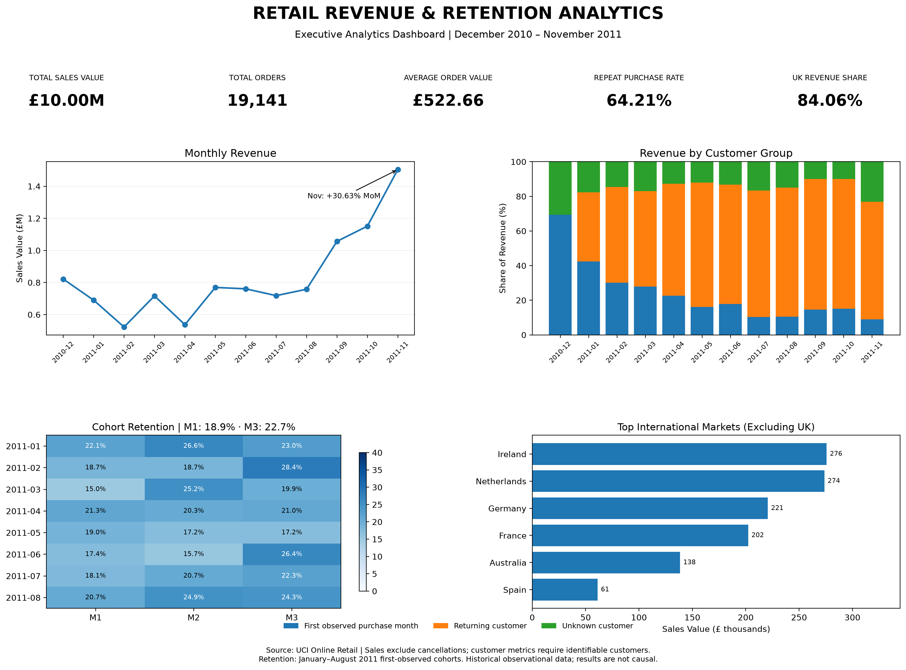
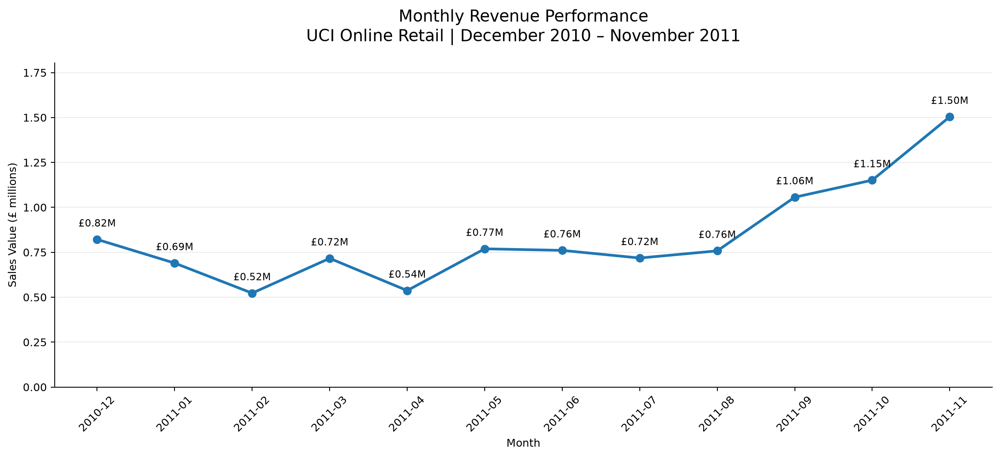
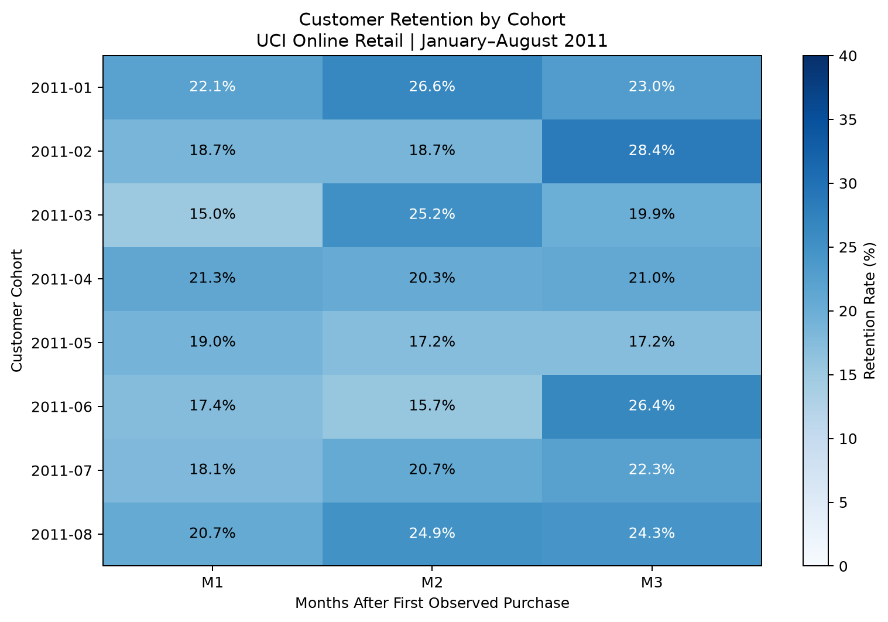
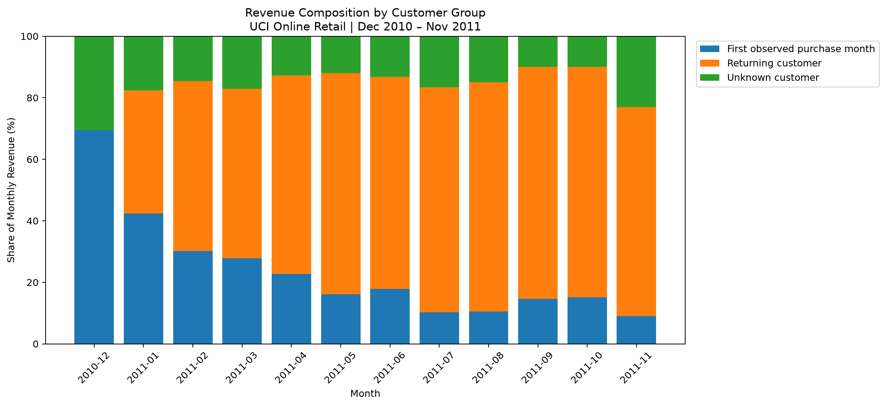
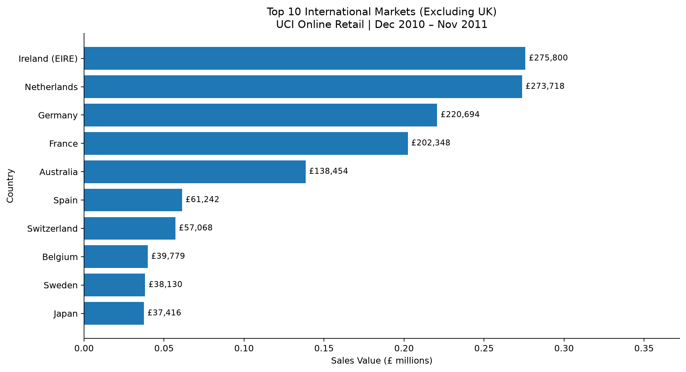
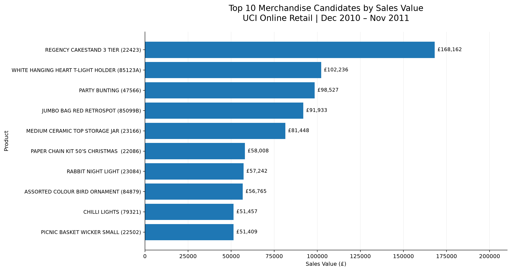

# Retail Revenue & Retention Analytics
## Business Insights Report

**Dataset:** UCI Online Retail  
**Analysis period:** December 2010 – November 2011  
**Tools:** PostgreSQL, SQL, Python, Pandas, dbt, Matplotlib

---

## 1. Executive Summary

*Executive overview of historical sales performance,
customer behaviour and geographic revenue distribution.
Created using Python, Pandas and Matplotlib.*

This project examines sales performance, customer purchasing
behaviour, retention, geographic revenue concentration, and
product performance using historical e-commerce transaction data.

The analysis covers 541,909 original transaction lines, with
524,878 rows classified as eligible sales under the project's
documented analytical rules.

Across the twelve complete months, eligible sales value
reached £10,004,320.47.

The analysis identifies several notable findings:

- November 2011 recorded the highest monthly sales value
  at £1.50 million, increasing by 30.63% month over month.
- The November increase was primarily associated with
  higher order volume rather than higher average order value.
- 64.21% of identifiable customers placed at least two
  observed orders during the analysis period.
- Weighted monthly retention ranged from 18.91% at M1
  to 22.74% at M3 for January–August 2011 cohorts.
- The United Kingdom accounted for 84.06% of eligible
  sales value.
- Sales without identifiable CustomerIDs accounted for
  a substantial share of the November revenue increase.

These findings highlight opportunities for further
investigation into purchasing frequency, customer
identification, geographic concentration, and product mix.

---

## 2. Business Context

The analysis addresses five main business questions:

1. How did sales performance change over time?
2. What role did repeat purchasing play in customer behaviour?
3. How did different customer groups contribute to revenue?
4. How concentrated were sales across geographic markets?
5. Which product codes generated the highest sales value?

The objective is to identify meaningful commercial patterns
and potential areas for further business investigation.

---

## 3. Data and Methodology

The project uses the historical UCI Online Retail dataset.

The original dataset contains 541,909 transaction lines,
covering December 2010 through early December 2011.

To avoid comparing incomplete calendar months, the primary
reporting period is restricted to December 2010 through
November 2011.

Data preparation preserves the original records while
creating documented eligibility flags for sales and
cancellations.

PostgreSQL and dbt are used to organise transactional data
into reusable analytical models.

The dbt pipeline contains ten view models and 48 automated
data tests. Its native PostgreSQL build completed successfully.

Python and Pandas support analytical transformations,
metric calculations, and data visualisation.

Sales value refers to eligible sales under the project's
defined rules. Cancellations are analysed separately rather
than deducted from sales totals.

---

## 4. Revenue Performance

### 4.1 Overall Sales

Total eligible sales value reached £10,004,320.47 across
19,141 orders.

The overall average order value was £522.66.

### 4.2 Monthly Revenue Growth

November 2011 recorded the highest monthly sales value:

- November sales value: £1,503,866.78
- Month-over-month growth: +30.63%
- Order growth: +35.74%
- Average order value growth: -3.76%

The increase in sales value was therefore associated
primarily with a higher number of orders.

The largest positive monthly growth rate occurred in
May 2011 (+43.27%).

The largest monthly decline occurred in April 2011
(-25.03%).

Sales value increased in September, October, and November,
although the dataset does not contain enough complete
annual cycles to establish recurring seasonality.

### Interpretation

Order volume appears to be a particularly important
component of the observed November sales increase.

Further analysis of product mix, customer groups, and
transaction characteristics would help explain the
underlying commercial activity.

---

## 5. Repeat Purchase Behaviour

Among 4,297 identifiable customers observed during the
analysis period, 2,759 placed at least two eligible orders.

This corresponds to a repeat purchase rate of 64.21%.

The remaining 1,538 identifiable customers placed only
one observed order during the reporting window.

### Interpretation

Repeat purchasing represented a substantial component
of observed customer behaviour.

However, this metric does not measure monthly retention
or establish long-term customer loyalty.

Purchases occurring before or after the available
observation window are not captured.

---

## 6. Customer Retention

Cohort analysis groups identifiable customers according
to the month of their first observed eligible purchase.

To compare cohorts with the same three-month observation
window, the weighted analysis uses January–August 2011
cohorts.

The December 2010 cohort is excluded from this comparison
because the dataset begins in that month.

### Weighted Retention Results

| Metric | Active Customers | Cohort Customers | Rate |
|---|---:|---:|---:|
| M1 | 460 | 2,432 | 18.91% |
| M2 | 525 | 2,432 | 21.59% |
| M3 | 553 | 2,432 | 22.74% |

These figures represent purchasing activity in each
specific subsequent month.

Customers may skip months and return later, meaning
monthly retention is not necessarily monotonically
decreasing.

### Interpretation

Retention varied across cohorts, indicating differences
in observed purchasing patterns.

The results support further investigation into
repeat-purchase timing and customer engagement.

They do not establish the effectiveness of any particular
retention or marketing intervention.

---

## 7. Customer Revenue Segmentation

Sales were classified into three groups:

- First-observed purchase month
- Returning customer
- Unknown customer

Returning customers were identifiable customers who had
made an eligible purchase in an earlier observed month.

Unknown customers were associated with sales for which
CustomerID was missing.

### September–November 2011 Revenue Composition

| Customer Group | September | October | November |
|---|---:|---:|---:|
| Returning customer | 75.34% | 74.89% | 67.90% |
| First-observed purchase month | 14.65% | 15.06% | 8.99% |
| Unknown customer | 10.01% | 10.04% | 23.12% |

### November Revenue Contribution

Between October and November:

- Unknown-customer sales increased by £232,039.89.
- Returning-customer sales increased by £158,857.02.
- First-observed-month sales decreased by £38,293.86.

Unknown-customer sales accounted for approximately
65.8% of the net monthly sales-value increase.

This is a contribution to the observed change, not
evidence that unidentified customers caused the increase.

### Interpretation

The growing value associated with missing CustomerIDs
limits customer-level attribution.

Additional investigation should determine whether the
change reflects differences in transaction channels,
customer identification practices, or purchasing behaviour.

---

## 8. Geographic Revenue Analysis

The United Kingdom accounted for 84.06% of total eligible
sales value.

International markets collectively represented 15.94%.

The largest non-UK markets included:

| Country | Sales Value |
|---|---:|
| Ireland (EIRE) | £275,799.63 |
| Netherlands | £273,718.32 |
| Germany | £220,694.23 |
| France | £202,348.45 |
| Australia | £138,453.81 |

### Interpretation

The business exhibited substantial geographic sales
concentration in the United Kingdom.

This concentration may expose overall sales performance
to changes in the domestic market.

However, the dataset does not provide sufficient
information on market profitability, shipping costs,
or customer acquisition costs to recommend geographic
expansion solely from sales figures.

---

## 9. Product Performance

Product-level analysis identified several stock codes
associated with relatively high eligible sales value.

The highest-ranked merchandise candidate was:

**Regency Cakestand 3 Tier (22423)**

- Sales value: £168,162.42
- Units sold: 13,402

The ten highest-ranked merchandise candidates generated
£817,186.30 in sales value.

This represented 8.52% of the £9,587,779.17 sales value
associated with stock codes passing the preliminary
merchandise-format filter.

The filter is based on StockCode structure and does
not constitute an exhaustive product classification.

### Interpretation

High sales volume and high sales value do not always
occur for the same products.

Further evaluation of pricing, gross margins,
transaction types, and product classifications would
be needed before making inventory or merchandising
decisions.

---

## 10. Business Recommendations

### Recommendation 1: Investigate Missing Customer Identifiers

Examine the completeness of CustomerID across months,
transaction channels, countries, and order types.

The objective is to understand why a substantial
portion of November sales cannot be attributed to
identifiable customers.

### Recommendation 2: Analyse Repeat-Purchase Opportunities

Investigate purchase frequency and the time between
successive orders.

Compare customer segments with different purchasing
patterns before designing retention initiatives.

### Recommendation 3: Examine Revenue Growth Drivers

Decompose monthly sales changes into order volume
and average order value.

Investigate whether customer composition, order size,
or product mix explains observed fluctuations.

### Recommendation 4: Evaluate Geographic Exposure

Assess the commercial implications of substantial
UK sales concentration.

Any expansion strategy should incorporate profitability,
logistics, market demand, and operational costs.

### Recommendation 5: Assess Product-Level Economics

Combine product sales value with unit economics,
margins, stock availability, and product classification.

Sales rankings alone should not determine inventory
investment decisions.

---

## 11. Limitations

This analysis has several important limitations.

**Historical data:** The transactions were recorded
in 2010–2011 and do not represent current market conditions.

**Observation window:** First observed purchase
does not necessarily mean first-ever purchase.
Historical customer activity before the dataset
is unavailable.

**Missing customer identifiers:** Transactions
without CustomerID cannot be reliably assigned
to identifiable customers.

**Retention interpretation:** Monthly retention
measures purchasing activity in particular months,
not continuous customer activity.

**Sales versus profit:** Sales value is not
equivalent to profit, audited revenue, or net
revenue after cancellations.

**Product classification:** Preliminary StockCode
filters do not guarantee a complete merchandise-only
product universe.

**Causality:** Observational transaction data
can identify associations, but cannot establish
causal effects of marketing or operational decisions.

---

## 12. Conclusion

The analysis provides a structured view of historical
e-commerce performance across sales, customer behaviour,
geographic markets, and product categories.

Its central finding is that revenue performance cannot
be understood through total sales alone.

Changes in order volume, customer composition,
identification completeness, and geographic
concentration all influence the interpretation
of business results.

Further investigation of these dimensions would
support more informed commercial decision-making.

---

## Technical Implementation

The analytical pipeline includes:

- Python-based data preparation
- PostgreSQL data storage and SQL analysis
- dbt staging, intermediate, and mart models
- 48 automated dbt data tests
- Cohort and customer segmentation analysis
- Matplotlib visualisations
- Executive analytics dashboard

See the repository README and supporting validation
reports for technical details and reproducibility notes.

